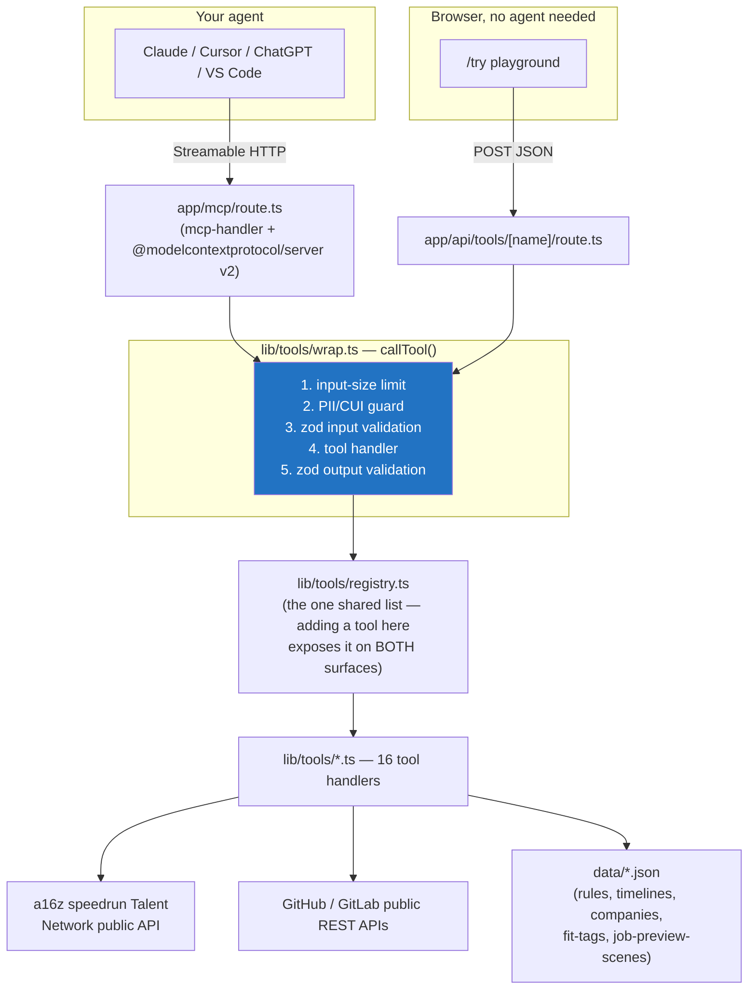

# Clearance Lens

A stateless remote **MCP server** + web app that helps people pursue US defense-tech roles **from inside the AI agent they already use** — Claude, Cursor, ChatGPT, Grok, VS Code — instead of joining yet another platform.

**Your agent does the private reasoning. The server is an almost entirely stateless, public-knowledge toolbox.** It never receives, stores, or logs PII, clearance details, or screenshots — it gives your agent rubrics, rules, timelines, and templates, and your agent evaluates them locally against what it already knows about you. (The one opt-in exception, and exactly what it does and doesn't store: see Architecture below.)

- **Production:** https://clearance-lens.vercel.app
- **MCP endpoint:** `https://clearance-lens.vercel.app/mcp`
- **Playground (no agent needed):** https://clearance-lens.vercel.app/try

---

## 60-second quickstart

**Add it to your agent** (pick one):

```bash
# Claude Code — one line
claude mcp add --transport http clearance-lens https://clearance-lens.vercel.app/mcp
```

```json
// Claude Desktop / claude.ai connectors, Cursor, VS Code, or any client
// that reads a generic mcpServers block — paste this and restart
{
  "mcpServers": {
    "clearance-lens": {
      "url": "https://clearance-lens.vercel.app/mcp"
    }
  }
}
```

For ChatGPT: **Settings → Connectors → Add custom connector**, name it `Clearance Lens`, paste the URL above, and leave authentication as "No auth."

Then just ask your agent something like:

> *"I'm a green-card holder — can I work the Anduril Fury role? How long would a Secret clearance realistically take?"*

No agent handy? Try every tool directly at **[/try](https://clearance-lens.vercel.app/try)** — it calls the exact same server, no LLM key required.

---

## What it does

| Tool | What it's for |
|---|---|
| `search_defense_roles` | Live defense/hard-tech roles from the a16z speedrun Talent Network's companies (not the whole defense market), with requirement signals labeled **stated** (quoted from the posting) vs **inferred** (a judgment call to confirm) |
| `get_role_rubric` | An eligibility checklist + skills rubric for your agent to evaluate **privately** |
| `estimate_timeline` | How long a clearance might realistically take — a real range where the data supports one, a single sourced figure where it doesn't, never an invented number |
| `readiness_brief` | A template your agent fills in locally: eligibility, gaps, a 2-week prep plan, and questions to ask the recruiter |
| `build_trial_assessment` | A 60/90/180-minute ITAR-safe work-sample exercise built only from the public posting |
| `explain_rule` | Plain-English ITAR/clearance rule explanations with primary-source links |
| `verify_evidence` | A GitHub, GitLab, or Cosign profile's already-public signal, via each platform's public API only |
| `run_job_preview` | A 6-scene "first week" realistic simulation — played straight, not sanitized |
| `fit_debrief` | Loved/disliked work-style tags → a summary template and questions to ask the company. Never a score. |
| `get_company_profile` | Published facts + computed work realities — returns *gaps*, not a guess, when no sourced criteria exist |
| `prepare_consented_card` | A shareable intro card from **only** the fields you explicitly approved |
| `prepare_signed_attestation` | Wraps a self-asserted claim (clearance level, citizenship status, or availability) in a credential your own agent signs locally — proves who signed it and when, never that the claim itself is true |
| `contribute_anonymous_signal` | Opts one role-interest into an anonymous, aggregated signal pool — no name, contact info, or identifier of any kind |
| `get_aggregated_signal` | Reads that pool back as rounded percentages for a role or company — never an individual record, never before at least 5 people have contributed |
| `generate_interview_guide` | A structured interview guide for a startup's own human panel, built only from the posting — traced questions and evaluation anchors, never a candidate score |
| `verify_signed_attestation` | The recipient's side of a signed attestation — checks it was really signed by the key it names and hasn't been altered, with a key fingerprint to recognize repeat signers. Never that the claim is true |

Every tool call returns `sources[]` and, where relevant, a `disclaimer`. Full specs: [`PLAN.md`](./PLAN.md) §2.

---

## Architecture



**Stateless by design, with one explicit, opt-in exception:** no database, no user accounts, no stored queries for 14 of 16 tools (see [`DECISIONS.md`](./DECISIONS.md) D-001/D-002). The one exception is `contribute_anonymous_signal`/`get_aggregated_signal` (D-037) — a candidate's agent can opt one role-interest into an anonymous, k-anonymity-floored aggregate pool (no identifier of any kind), which anyone can read back as a rounded percentage. Calling neither tool means none of this applies. The MCP route and the `/try` playground call the **exact same** `lib/tools/*` implementations through the same `callTool()` pipeline — there is no second copy of any tool's logic.

---

## Development

```bash
pnpm install
pnpm dev                 # http://localhost:3000
```

```bash
pnpm verify               # lint + typecheck + unit tests + link check (fast, no server needed)
pnpm test                 # unit tests only
MCP_URL=http://localhost:3000/mcp pnpm test:protocol   # real MCP client against a running server
pnpm test:e2e              # Playwright — needs a build; see playwright.config.ts
```

Requires Node `>=22.19.0` (see [`DECISIONS.md`](./DECISIONS.md) D-011) and pnpm.

### Project layout

```
app/
  mcp/route.ts                 the MCP server (tools, resources, prompts)
  api/tools/[name]/route.ts    the /try playground's API surface — same tools, same guard
  api/health/route.ts
  page.tsx  try/  privacy/  sources/
lib/
  tools/*.ts                   one file per MCP tool; tools/registry.ts lists them all
  tools/wrap.ts                 the shared callTool() pipeline (PII guard, validation, errors)
  guard/pii.ts                  the PII/CUI detector
  speedrun/  github/            typed API clients
data/                           rules.json, timelines.json, companies.json, fit-tags.ts, job-preview-scenes.ts
components/                     design-system components (see research/R2-design-system.md)
research/                       Phase R research reports (R1–R5), each fully cited
tests/
  unit/      protocol/      e2e/
```

---

## Privacy, sources, and limitations

- **[/privacy](https://clearance-lens.vercel.app/privacy)** — exactly what's sent, stored (almost nothing — see the one opt-in exception above), logged (no bodies), and refused.
- **[/sources](https://clearance-lens.vercel.app/sources)** — every rule and statistic this product uses, with a primary-source link and a last-verified date. See also [`SOURCES.md`](./SOURCES.md).
- This is **not legal advice**. Verify anything that matters with your Facility Security Officer or counsel.
- Clearance Lens never queries DISS/NBIS/DCSA and never asks for clearance screenshots — the only legitimate verification path is your employer's FSO at the offer stage.

Project history, decisions, and the honest current state: [`DECISIONS.md`](./DECISIONS.md), [`CHANGELOG.md`](./CHANGELOG.md), [`STATUS.md`](./STATUS.md).
